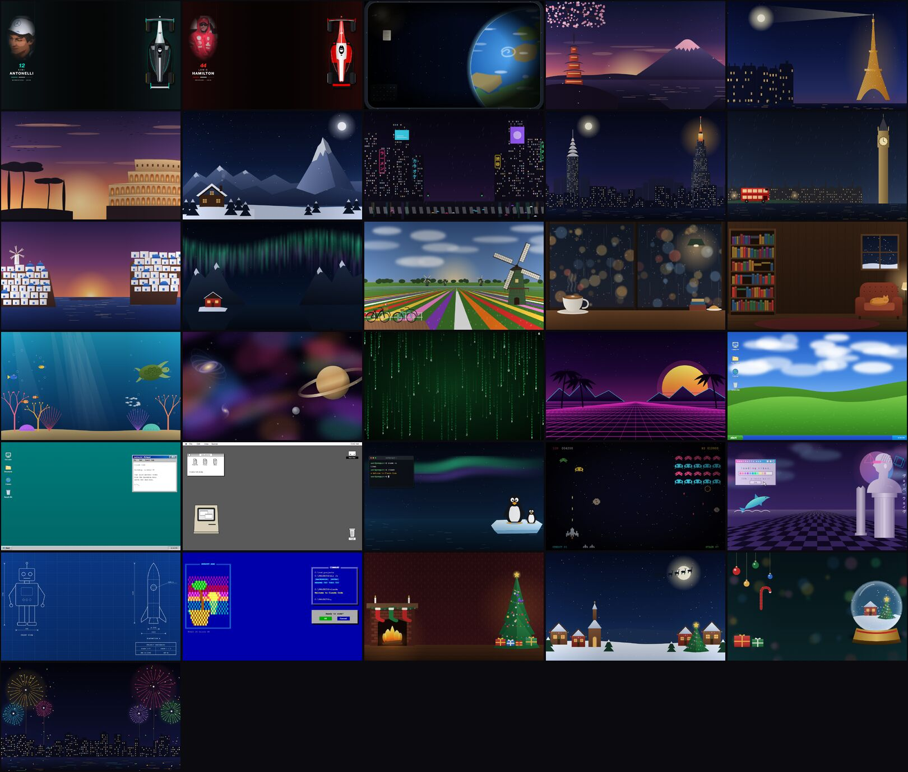

# backdrops

A Claude Code mod that puts a scene behind the conversation in the Claude desktop app, with a matching dark color theme. It has thirty-one themes: Formula 1, travel, places, calm and cozy, retro, retro tech and holidays. Switch between them with a picker above the chat box or a slash command such as `/backdrops:paris`.



## Install

```
/plugin marketplace add donvito/skillsbento
/plugin install backdrops@skillsbento
```

In the desktop app, where `/plugin` doesn't run, click **+** next to the prompt box, then **Plugins**, then **Add marketplace** with `donvito/skillsbento`, then add **backdrops**. Restart the app afterwards.

Backdrops draw in the Claude desktop and mobile apps. The terminal and IDE extensions don't draw them. There, a command still saves your pick and says why nothing changed.

## Themes

### Formula 1

| Command | Backdrop |
| --- | --- |
| `/backdrops:mercedes-kimi` | Kimi Antonelli's Mercedes, #12: a portrait and the car from above, in black, silver and turquoise |
| `/backdrops:ferrari-hamilton` | Lewis Hamilton's Ferrari, #44: a portrait and the car from above, in red, white and black |

### Travel

| Command | Backdrop |
| --- | --- |
| `/backdrops:space-shuttle` | Looking out a shuttle window at Earth: continents, clouds, a cyclone, city lights on the night side |
| `/backdrops:mt-fuji` | Fuji at dusk over a lake, with a five-storey pagoda and cherry blossom |
| `/backdrops:paris` | The Eiffel Tower lit gold at night, with its beacon, the moon and Paris rooftops |
| `/backdrops:rome` | The Colosseum at golden hour, with stone pines and swifts |
| `/backdrops:swiss-alps` | A moonlit Matterhorn, a chalet with chimney smoke, and falling snow |
| `/backdrops:tokyo-shibuya` | Shibuya crossing at night in the rain, with neon signs and people crossing |

### Places

| Command | Backdrop |
| --- | --- |
| `/backdrops:new-york` | The Manhattan skyline at night, with the Empire State Building lit and an art deco crown |
| `/backdrops:london` | Big Ben and Westminster in the rain, with a red double-decker bus on the bridge |
| `/backdrops:santorini` | White houses and blue domes on the cliffs, a windmill, and the sea at sunset |
| `/backdrops:northern-lights` | A red cabin by a fjord under a big green and violet aurora |
| `/backdrops:netherlands` | Tulip fields in stripes of colour, a canal and green polders at golden hour, a big windmill, and two Dutch bikes by the railing |

### Calm and cozy

| Command | Backdrop |
| --- | --- |
| `/backdrops:rainy-cafe` | Rain on a café window, a steaming latte, a pendant lamp and warm city lights outside |
| `/backdrops:cabin-library` | Bookshelves, a leather armchair with a sleeping cat, a reading lamp and snow at the window |
| `/backdrops:underwater-reef` | Coral, clownfish, a school of fish, a sea turtle and light rays from above |
| `/backdrops:deep-space` | A colourful nebula, a ringed planet with a moon, and distant spiral galaxies |

### Retro

| Command | Backdrop |
| --- | --- |
| `/backdrops:matrix` | Green code raining down a black screen |
| `/backdrops:retro-80s` | A synthwave sunset with a striped sun over a neon grid, mountains and palms |
| `/backdrops:windows-xp` | Rolling green hills under a blue sky, desktop icons and a blue taskbar |
| `/backdrops:windows-98` | A teal desktop with icons, a classic grey Notepad-style window and taskbar |
| `/backdrops:macintosh-retro` | A dithered grey desktop, a menu bar, a pinstriped window, a beige computer and disk icons |
| `/backdrops:linux` | A cartoon penguin and its chick on an ice floe under an aurora, beside a terminal window |

### Retro tech

| Command | Backdrop |
| --- | --- |
| `/backdrops:pixel-arcade` | An original 8-bit space shooter on a CRT screen, with scanlines, a score and enemy waves |
| `/backdrops:vaporwave` | A pastel twilight with stars and a dark checkerboard floor, a glowing pastel planet, an "ａｅｓｔｈｅｔｉｃ.exe" window with a loading bar, a leaping dolphin, and a marble bust beside a broken column |
| `/backdrops:blueprint` | Technical drawings of a rocket and a robot, with dimensions and a title block, on blue grid paper |
| `/backdrops:dos-prompt` | A blue text-mode screen with ANSI-style block art of a sunset island and a DOS-style prompt |

### Holidays

| Command | Backdrop |
| --- | --- |
| `/backdrops:christmas-fireplace` | A cosy room: a crackling fire with stockings and candles, a decorated tree with lights, and presents |
| `/backdrops:christmas-village` | A snowy village at night with string lights, a little church, and a sleigh and reindeer crossing the moon |
| `/backdrops:christmas-snowglobe` | A snow globe with a little house and lit tree inside, soft festive lights, ornaments and a candy cane |
| `/backdrops:new-year` | Fireworks bursting over a city skyline and river, with confetti |

`/backdrops:off` removes the backdrop and goes back to the default look.

You can also type them without the prefix as `/backdrop-<name>`, for example `/backdrop-paris` or `/backdrop-off`. Your pick is saved and comes back in new chats until you choose **None** or run `/backdrops:off`.

### Theme picker

In the desktop app, a **Backdrop** dropdown sits in the band just above the chat box. It shows the current theme. Picking one switches it at once and saves it for new chats.

## How the scenes are made

The desktop app frosts the conversation column, so each scene keeps its subject in the side gutters, where it stays visible. On narrower windows the subjects move inward, and in portrait windows the F1 car moves across the top. Every scene is vector art under the app's 131,072-character limit for a backdrop.

What the app can show shaped these choices. In Claude Code 2.1.325:

- **No photos.** The desktop app drops raster images from a backdrop. The driver portraits are real, freely licensed photos traced into vector shapes, which it does draw. See [photos/CREDITS.md](photos/CREDITS.md).
- **No animation.** The app paints a backdrop as a still frame and runs neither CSS nor SMIL animation in it. Redrawing on a timer makes it flicker. So each scene is drawn once, at a moment where its moving parts (snow, petals, rain, walkers, the Paris beacon) are spread across it. The scenes keep their CSS animation, with delays offset by `var(--t)`, so they'll move as-is if a later app version animates backdrops.
- **Slash menu.** The desktop menu lists a plugin's command files, so each theme has a file in `commands/`. The mod answers it before the model sees it.

## Rebuilding the scenes

The scenes are generated. Edit the scripts in `tools/`, then rebuild:

```bash
python3 tools/build_scenes.py hooks/scenes
```

```bash
python3 tools/build_travel.py hooks/scenes
```

```bash
python3 tools/build_retro.py hooks/scenes
```

```bash
for g in build_scenes build_travel build_retro build_christmas build_places build_cozy build_tech; do python3 tools/$g.py hooks/scenes; done; rm hooks/scenes/*.svg
```

- `build_scenes.py` draws the two F1 scenes: the driver panel and the top-down car.
- `build_travel.py` draws the six travel scenes.
- `build_retro.py` draws the six retro scenes.
- `build_christmas.py` draws the three Christmas scenes.
- `build_places.py` draws New York, London, Santorini, the northern lights, the Netherlands and New Year's Eve.
- `build_cozy.py` draws the rainy café, cabin library, underwater reef and deep space.
- `build_tech.py` draws the pixel arcade, vaporwave, blueprint and DOS prompt.
- `smil.py` holds the `var(--t)` time offset both scripts apply.
- `trace.py` traces a photo to vector shapes. It needs `pip install vtracer`.
- `build_stills.py` renders the F1 layout with the real photos to full-window JPEGs, for an app version that draws still image backdrops. It needs Google Chrome and ImageMagick.

To use your own driver photo, trace it with `trace.py`, save it as `photos/<driver>.svg`, and rebuild.

## Develop

```bash
claude plugin validate plugins/backdrops
```

```bash
claude plugin test plugins/backdrops
```

To try a change without reinstalling, run `claude --plugin-dir plugins/backdrops`.

## Credits

The driver photos and car photos are from Wikimedia Commons under CC BY-SA 4.0. Their authors and links are in [photos/CREDITS.md](photos/CREDITS.md). This mod is unofficial and isn't affiliated with Formula 1, any team or any driver. The retro themes are original art in the style of their eras: they use no company logos, wallpapers or icon artwork, and the names Windows, Macintosh and Linux only describe the era. Those names are trademarks of their owners, and the mod isn't affiliated with them. The penguin is an original drawing, not the Tux artwork. The pixel-arcade sprites, the marble bust and the blueprint drawings are original too.
